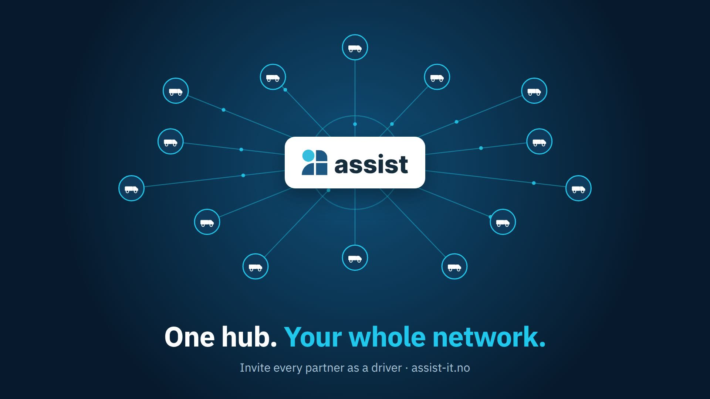
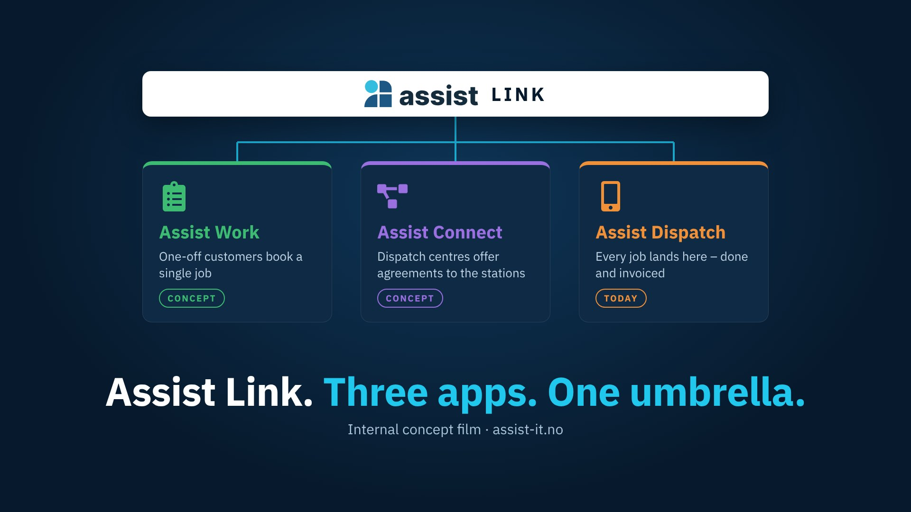
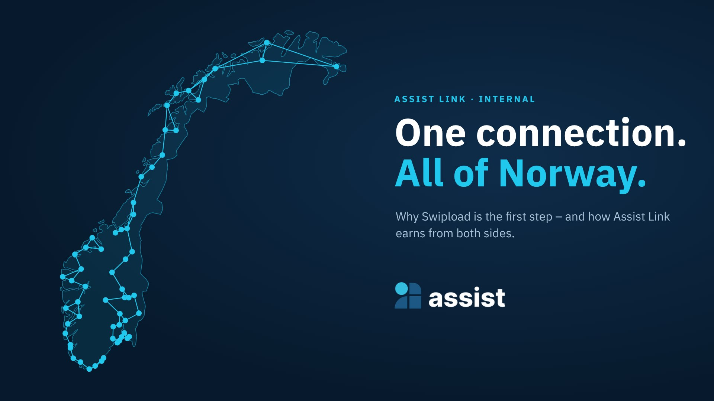

# Assist videos

Product videos for **[Assist](https://www.assist-it.no/en)** – dispatch and job management for roadside assistance and special transport.

## One hub. Your whole network. (46 sec)

Assist as a central dispatch hub: from the customer's QR scan to a completed and invoiced mission, in one platform.

▶ **[Watch the video](https://lrudlang-cloud.github.io/Assist-videos/)** · [Download MP4](videos/assist-dispatch-hub.mp4)

1. **Scan & share location** – the customer scans a QR code and sends a request with exact GPS.
2. **Instant alert** – your call centre is notified and accepts the request.
3. **Every partner on one map** – see the customer and all partners in your network.
4. **Dispatch in one click** – pick the closest start point and send the mission to the driver.
5. **Live on the road** – the driver accepts in the Assist app, and you follow the route live.
6. **Done & invoiced** – status, documentation and payment in the same mission.

## Assist Link – Three apps. One umbrella. (82 sec, internal)

Concept film for employees, board and investors: Assist Work, Assist Connect and Assist Dispatch, and how planned transport jobs reach the stations. Work and Connect are not built yet.

▶ **[Watch the video](https://lrudlang-cloud.github.io/Assist-videos/assist-link/)** · [Download MP4](videos/assist-link.mp4)

## Assist Link – One connection. All of Norway. (3 min 52 sec, internal)

Concept film for employees and board: the three apps in Assist Link, why Swipload is the first step, and how Assist earns from both sides. English and Norwegian versions, with subtitles.

▶ **[Watch the video](https://lrudlang-cloud.github.io/Assist-videos/assist-link-one-connection/)** · [Download MP4 (English)](videos/assist-link-one-connection.mp4) · [Last ned MP4 (norsk)](videos/assist-link-one-connection-no.mp4)

---

Want to see Assist in action? **[Book a demo at assist-it.no](https://www.assist-it.no/en)**

© Assist IT AS
