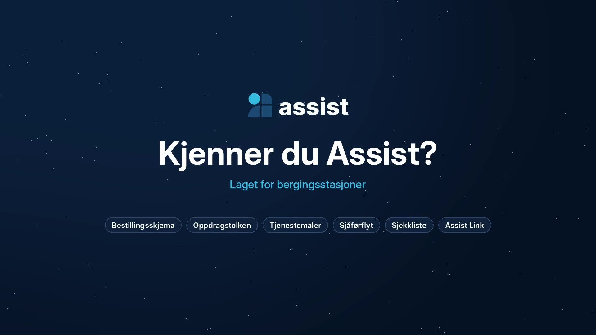
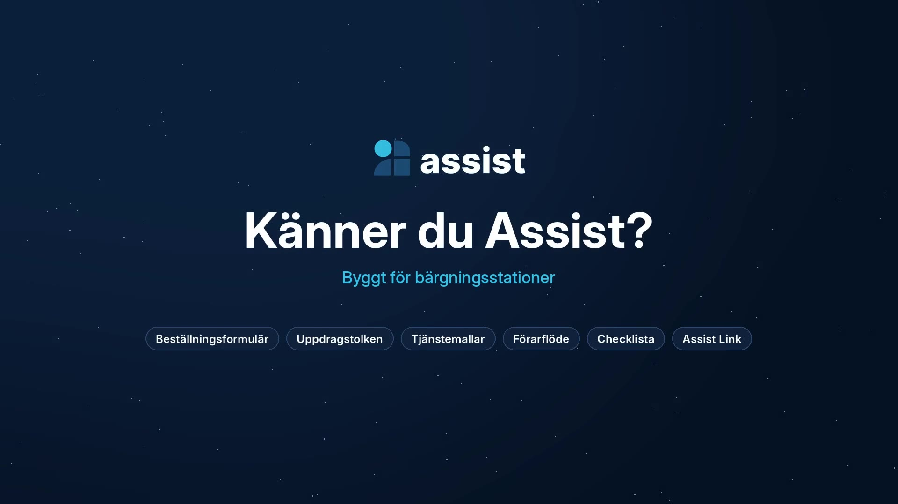
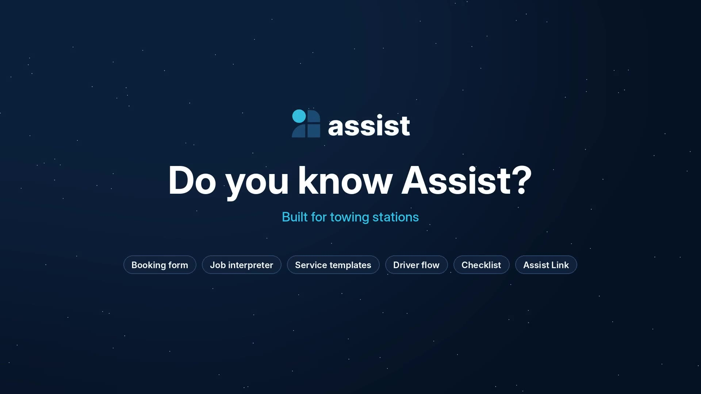

# Assist videos

Product videos for **[Assist](https://www.assist-it.no/en)** – dispatch and job management for roadside assistance and special transport.

## One hub. Your whole network. (46 sec)

Assist as a central dispatch hub: from the customer's QR scan to a completed and invoiced mission, in one platform.

▶ **[Watch the video](https://lrudlang-cloud.github.io/Assist-videos/)** · [Download MP4](videos/assist-dispatch-hub.mp4)

1. **Scan & share location** – the customer scans a QR code and sends a request with exact GPS.
2. **Instant alert** – your call centre is notified and accepts the request.
3. **Every partner on one map** – see the customer and all partners in your network.
4. **Dispatch in one click** – pick the closest start point and send the mission to the driver.
5. **Live on the road** – the driver accepts in the Assist app, and you follow the route live.
6. **Done & invoiced** – status, documentation and payment in the same mission.

## Kjenner du Assist? (85 sec, Norwegian)

Assist for towing stations that are not customers yet: one job from the moment it comes in until it is done, and what we are building now. Norwegian voice, text and UI.

▶ **[Se filmen](https://lrudlang-cloud.github.io/Assist-videos/kjenner-du-assist/)** · [Last ned MP4](videos/kjenner-du-assist.mp4)

1. **Bestillingsskjema** – regular customers book themselves from the station's own website.
2. **Oppdragstolken** – an AI agent reads the message from the dispatch centre and creates the job in seconds.
3. **Tjenestemaler** – pick the type of job, and the work description and checklist follow.
4. **Sjåførflyt** – the driver gets the job on the phone; one big button always shows the next step.
5. **Sjekkliste på jobben** – photos, SMS to the customer and deductible. Nothing is forgotten.
6. **Assist Link (being built now)** – stations, dispatch centres and other customers work together, also across the border between Norway and Sweden, and accepted jobs land in Assist Dispatch.

## Känner du Assist? (100 sec, Swedish)

Swedish version of «Kjenner du Assist?», with Swedish voice and text. The Assist screens are shown in Norwegian.

▶ **[Se filmen](https://lrudlang-cloud.github.io/Assist-videos/kanner-du-assist/)** · [Ladda ner MP4](videos/kanner-du-assist-sv.mp4)

## Do you know Assist? (76 sec, English)

English version of «Kjenner du Assist?», with English voice and text. The Assist screens are shown in Norwegian.

▶ **[Watch the video](https://lrudlang-cloud.github.io/Assist-videos/do-you-know-assist/)** · [Download MP4](videos/do-you-know-assist-en.mp4)

## Assist Link – Three apps. One umbrella. (82 sec, internal)

Concept film for employees, board and investors: Assist Work, Assist Connect and Assist Dispatch, and how planned transport jobs reach the stations. Work and Connect are not built yet.

▶ **[Watch the video](https://lrudlang-cloud.github.io/Assist-videos/assist-link/)** · [Download MP4](videos/assist-link.mp4)

## Assist Link – One connection. All of Norway. (3 min 52 sec, internal)

Concept film for employees and board: the three apps in Assist Link, why Swipload is the first step, and how Assist earns from both sides. English and Norwegian versions, with subtitles.

▶ **[Watch the video](https://lrudlang-cloud.github.io/Assist-videos/assist-link-one-connection/)** · [Download MP4 (English)](videos/assist-link-one-connection.mp4) · [Last ned MP4 (norsk)](videos/assist-link-one-connection-no.mp4)

---

Want to see Assist in action? **[Book a demo at assist-it.no](https://www.assist-it.no/en)**

© Assist IT AS
